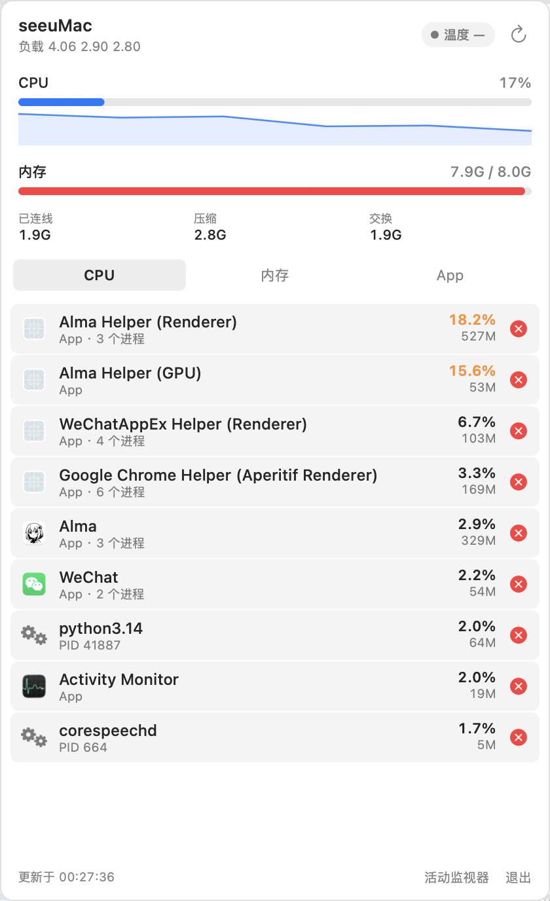

# SeeUMac

A native macOS menu bar system monitor that does the one thing Activity Monitor can't: **let you kill things from the menu bar, grouped by app.**

Written in pure AppKit. No dependencies, no Electron, ~300 KB, and it idles at **0.3–0.5% CPU**.



---

## Why

I wanted to know why my M1 was running hot. Every monitor app shows you numbers — CPU, memory, network — and then leaves you to open Activity Monitor, hunt the process down, and kill it.

The interesting part turned out to be **which** process to kill. Electron apps spawn 5–8 helper processes; they look like noise in a flat process list. Killing one `Helper (Renderer)` does nothing useful. Killing the whole group does.

So: aggregate by app, one row per app, one button to end all of it.

---

## Features

**Menu bar icon** — three small bars: CPU, memory, and the peak of the two. Template image, adapts to light/dark menu bars. Hover for exact numbers.

**Panel** — click the icon:

| Section | Contents |
|---|---|
| Header | app name, load average (1/5/15m), thermal pressure, refresh |
| CPU | current usage + 60-point sparkline; orange above 60%, red above 80% |
| Memory | used/total, wired, compressed, swap |
| Tabs | top by **CPU** / by **memory** / **apps only** |
| Rows | icon, name, helper count, CPU%, memory, kill button |
| Footer | timestamp, open Activity Monitor, quit |

**Kill by app** — the × button ends the whole process group:

- `SIGTERM` first, `SIGKILL` after a 3-second grace period
- System-critical processes are protected (`launchd`, `WindowServer`, `Dock`, `Finder`, `coreaudiod`, …)
- Targets above 40% CPU or with more than 3 processes get a confirmation dialog
- It won't kill itself

---

## Install

Requires macOS 13+ and the Swift toolchain (`xcode-select --install` is enough — **no full Xcode needed**).

```bash
git clone https://github.com/ne0-svg/seeumac-system-monitor.git
cd seeumac-system-monitor
./build.sh
```

`build.sh` compiles, ad-hoc signs, installs to `/Applications`, and launches it.

To run at login, create `~/Library/LaunchAgents/com.seeumac.menubar.plist`:

```xml
<?xml version="1.0" encoding="UTF-8"?>
<!DOCTYPE plist PUBLIC "-//Apple//DTD PLIST 1.0//EN" "http://www.apple.com/DTDs/PropertyList-1.0.dtd">
<plist version="1.0">
<dict>
  <key>Label</key><string>com.seeumac.menubar</string>
  <key>ProgramArguments</key>
  <array><string>/Applications/SeeUMac.app/Contents/MacOS/SeeUMac</string></array>
  <key>RunAtLoad</key><true/>
  <key>KeepAlive</key><false/>
  <key>ProcessType</key><string>Interactive</string>
</dict>
</plist>
```

```bash
launchctl load ~/Library/LaunchAgents/com.seeumac.menubar.plist
```

To build without installing: `./build.sh --no-install`

---

## Source layout

~1,500 lines of Swift, four files.

| File | Responsibility |
|---|---|
| `Sources/SystemSampler.swift` | Sampling: system CPU, memory, swap, thermal pressure, process list |
| `Sources/ProcActions.swift` | App-level aggregation, process termination, icon caching |
| `Sources/UIPanel.swift` | Custom-drawn controls: sparkline, bar, process row, tab buttons |
| `Sources/main.swift` | Status bar item, panel window, app lifecycle |

---

## Measured cost

Machine: Apple M1, 8 cores, macOS 26.2. 322 processes at sample time.

| Metric | Value |
|---|---|
| Full sample (322 processes) | 7–15 ms |
| Sample interval | 3 s |
| Resident CPU | 0.3–0.5% average, ~4% short spike per sample |
| Memory (footprint) | 96–140 MB |
| App bundle | 300 KB |
| Binary | 297 KB |

For comparison, an Electron app with a couple of windows routinely holds 20–30% CPU and 550 MB.

---

## Implementation notes

These are the parts that cost me real time. Read them before editing.

### `pti_total_user` only counts the main thread

`proc_pidinfo(PROC_PIDTASKINFO)` returns `pti_total_user` / `pti_total_system`. On a multi-threaded process these are **wildly** wrong. Measured on a 24-thread Electron renderer: the field reported 21.8 CPU-seconds while the process had actually consumed 907. That's a 40× error.

You have to sum `pth_user_time + pth_system_time` (nanoseconds) across every thread:

```swift
proc_pidinfo(pid, PROC_PIDLISTTHREADS, 0, &buf, ...)   // get thread IDs
proc_pidinfo(pid, PROC_PIDTHREADINFO, tid, &info, ...) // per thread
```

Note that `PROC_PIDTHREADINFO` with `tid = 0` returns nothing — you must list the IDs first.

Curiously, both `ps -o pcpu` and `top` report the right numbers. Only these two `proc_pidinfo` interfaces are affected.

### `NSWorkspace.icon(forFile:)` is not safe to call every sample

Re-fetching icons on each tick pushed CPU past 20%. Icons are static — cache them (`ProcActions.cachedIcon`, guarded by an `NSLock`).

### NSStackView constraint ordering

Activating `row.widthAnchor.constraint(equalTo: stack.widthAnchor)` **before** `stack.addArrangedSubview(row)` throws at runtime:

```
NSGenericException: no common ancestor
```

Add the view first, then activate.

### Guard `refresh()` until the view is built

A sampling callback can fire while `loadView()` is still running, before every control exists. Use a `ready` flag.

### `NSPopover` fails silently in accessory apps

`NSPopover.show(relativeTo:of:)` does nothing in an `.accessory` app with no dock icon. Use your own `NSPanel` instead:

```swift
styleMask: [.borderless, .nonactivatingPanel]
level = .statusBar
```

Then clamp the frame to `NSScreen.visibleFrame` yourself.

### The menu bar icon moves

If any third-party app resizes its status item dynamically, positions shift between layouts. Never hard-code coordinates to click a status item — query it:

```applescript
tell application "System Events" to tell process "SeeUMac" to ¬
    get position of menu bar item 1 of menu bar 1
```

### The UI must not be rebuilt every sample

Rebuilding the row views on each tick cost ~25% CPU. Only rebuild when the *set* of rows changes (join the IDs into a key); otherwise update the label strings in place.

---

## Known limitations

- **Aggregation key** is the bundle ID. Good for grouping Electron helpers, but two apps sharing a bundle ID would merge incorrectly.
- **Memory** is reported as physical footprint, close to Activity Monitor's "Memory" column but not identical to `top`'s wired-based figure.
- **Temperature** comes from `kern.thermal_pressure_level`, which only yields four levels (Normal/Fair/Serious/Critical). Some machines return nothing. Exact degrees require `powermetrics` (root) or SMC access via IOKit — not implemented.
- **No sort toggle.** The three tabs are fixed to CPU descending, memory descending, and app CPU descending.
- **Ad-hoc signed.** Runs on your machine only. Distributing it requires a Developer ID certificate, or Gatekeeper will block it.

---

## Roadmap

Ideas worth doing, roughly by value:

1. **Restart instead of kill** for Electron apps — gentler and often what you actually want
2. **Process tree view** — show which parent a helper belongs to instead of inferring from the path
3. **Network and disk I/O** — the other two heat sources, currently blank
4. **History** — keep 24 hours of peaks, to answer "when did it start running hot?"
5. **Fan speed and temperature sensors** via IOKit SMC
6. **Rule-based automation** — e.g. "end Simulator processes 5 minutes after Xcode quits"

---

## License

MIT
